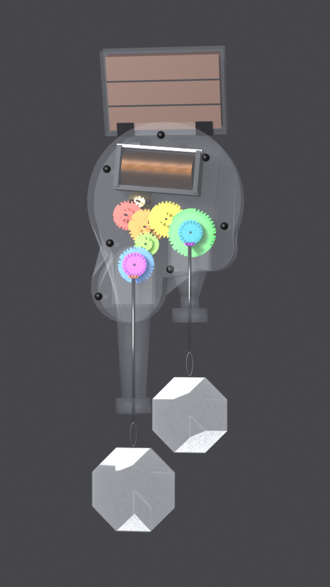
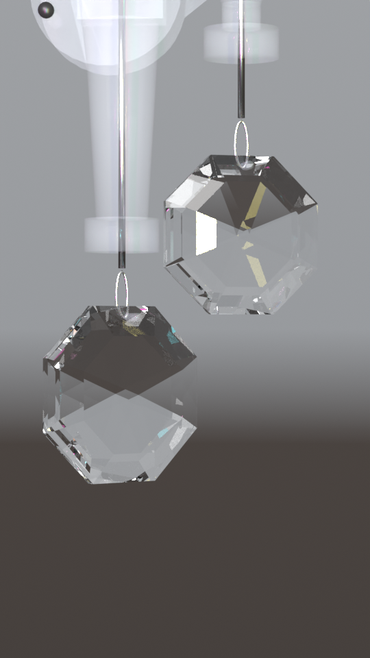

# The Rainbow Maker

*By Astra.* A VRChat world around a solar Rainbow Maker: watch its tiny gear train turn and spin a crystal that throws
rainbows across the room.

## The Rainbow Maker

A model of Astra's own double-crystal Kikkerland solar Rainbow Maker whose gears really turn.

<table>
<tr>
<th width="50%">The gear train</th>
<th width="50%">The crystals</th>
</tr>
<tr>
<td width="50%"></td>
<td width="50%"></td>
</tr>
</table>

**Not on VRChat yet.** The world is being built; when it is published, its link goes here.

**Needs:** VRChat on a PC, in VR or on desktop.

## Developer Notes

1. Unity 2022.3.22f1, started fresh from VRChat Creator Companion's World template 1.5.0, with the VRChat SDK (com.vrchat.base 3.10.5, com.vrchat.worlds 3.10.5) unpacked from VCC's package cache into `Packages/` (not committed). Spawned with world-spawn-tool 0.2.0-20261019 on 20261022; nothing in it came from another world.
2. Agents drive an open editor through `Review/agent-queue/*.cmd` (`status`, `refresh`, `save`, `menu TheRainbowMaker/...`). Never relaunch or batchmode Unity while the project is open.
3. A piece from another world comes in only when Astra names it.
4. Uploads, releases and `main` change only with Astra's OK.
5. **The model** is rebuilt in Blender from `Art/rainbow-maker/build-rainbow-maker-20261022.py`; the scene with the menu
   **TheRainbowMaker/Build Scene**.

## Credits

1. The Rainbow Maker is a Kikkerland product; the model follows Astra's own unit and her photos of it.
2. The model, the crystals and the world: built with Claude Opus 5.5, from 2026-10-22.

## License

No general source license is granted yet. Third-party assets keep their own licenses.
